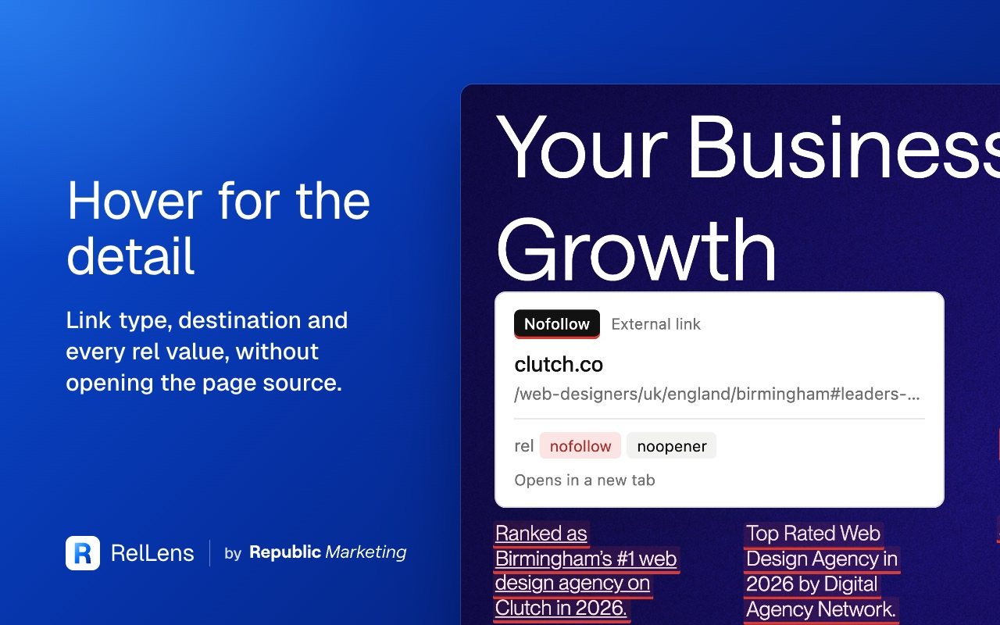
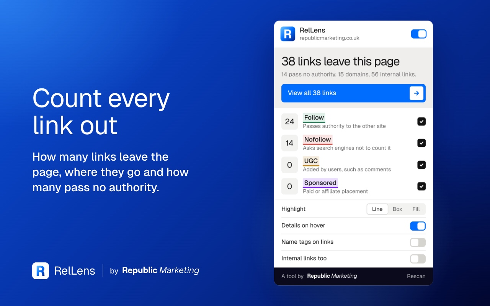

# RelLens

A free Chrome extension that shows which links on a page are follow, nofollow, UGC or sponsored.

Made by [Republic Marketing](https://www.republicmarketing.co.uk), a [web design agency in London](https://www.republicmarketing.co.uk/web-design-london) and Birmingham.

## What it does

Click the RelLens icon on any page and every outbound link is marked by type:

- Follow links in green
- Nofollow links in red
- UGC links in amber
- Sponsored links in purple

You also get:

- **A count** of how many links leave the page, how many domains they go to and how many pass no authority.
- **A hover card** on any link with its type, destination and every rel value.
- **A searchable list** of every link. Click a row and the page scrolls to it.
- **Copy and CSV export** for link audits.
- **Internal links** on request, including internal links marked nofollow.
- **Filters** to hide or show each link type.

## How it works

- RelLens runs only when you click its icon or press `Alt+Shift+L`. It asks for no access to any site in advance (`activeTab` only).
- It never changes the page it checks. Highlights are drawn in an overlay inside a closed shadow root, so site styles cannot hide them and layouts do not break.
- It marks text links, image links, buttons and cards, links inside open shadow roots, and links added after the page loads.
- Marks are hidden for links that are clipped by a scroll container or covered by a sticky header.
- It flags pages that carry a robots nofollow meta tag.

## Privacy

RelLens works entirely in your browser. No account, no tracking, no analytics, and nothing is sent anywhere. See the [privacy policy](https://www.republicmarketing.co.uk/rellens-privacy-policy).

## Install from source

1. Download or clone this repository.
2. Open `chrome://extensions` and switch on Developer mode.
3. Click "Load unpacked" and choose the repository folder.

## Files

| File | Purpose |
| --- | --- |
| `manifest.json` | Extension manifest (Manifest V3) |
| `content.js` | Finds links, measures them and draws the overlay and hover card |
| `popup.html`, `popup.css`, `popup.js` | The popup |
| `background.js` | Toolbar badge and keyboard shortcut |
| `dev/test.html` | A test page of awkward link types, run against a stand-in for the extension API (`dev/shim.js`) |

To run the test page, serve the folder locally (for example `python3 -m http.server`) and open `/dev/test.html`.

## Credits

Built and maintained by [Republic Marketing](https://www.republicmarketing.co.uk). The popup uses the Geist typeface under the SIL Open Font License.

Copyright Republic Marketing LTD. All rights reserved.
